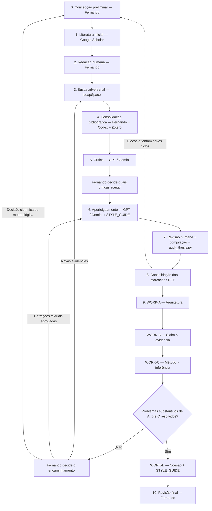

# Research Protocol — Tese

Este documento contém os protocolos operacionais do projeto de tese.
As regras aqui registradas devem ser tratadas como fonte de referência para execução de tarefas por agentes de IA.

## Convenção de relatórios e continuidade

- `2_INTI/audit/`: relatórios técnicos, logs, diffs, saídas de testes e demais registros de auditoria. É local e ignorado pelo Git.
- `2_INTI/audit/works/[artigo]/`: relatórios científicos WORK-A, WORK-B, WORK-C e WORK-D; para H1, usar o diretório existente `2_INTI/audit/works/chap1/`.
- `2_INTI/audit/zotero/`: conferências bibliográficas e registros de correspondência entre LaTeX, BibTeX e Zotero.
- Registre decisões e contexto de continuidade no relatório pertinente, quando necessário, evitando criar uma trilha paralela.

Essa convenção acompanha a reorganização de 12/10/2026. Esses relatórios são locais e devem ser protegidos pelo backup Restic; não são sincronizados com o GitHub pela configuração atual do `.gitignore`.

Os antigos diretórios `reports/`, `thread/`, `code/` e `xreports/` estão preservados em `2_INTI/xlegado/`. Não recriá-los como estruturas ativas por padrão.

## Unidade de trabalho — blocos REF

Neste fluxo, uma claim é tratada operacionalmente como um bloco argumentativo completo, identificado por uma marcação como `%%% REF6`. Um bloco pode reunir vários parágrafos e afirmações relacionadas.

- O bloco começa na marcação `%%% REF...` e termina na próxima marcação desse tipo ou no fim do arquivo.
- Comentários iniciados por `%%` descrevem os componentes do bloco e ajudam a localizar os achados da revisão.
- Identifique o bloco junto com seu arquivo, por exemplo: `chap1/0_introduction.tex, REF6`.
- Preserve os identificadores existentes. Não é necessário numerar cada frase, atribuir códigos adicionais ou etiquetar retrospectivamente todo o texto.
- Perguntas e objetivos são avaliados quanto à coerência e ao alcance anunciado; afirmações científicas são confrontadas com as fontes pertinentes.

A avaliação das evidências e as decisões do autor ficam registradas nos relatórios WORK-B, com referência ao arquivo, ao bloco REF e às citekeys pertinentes.

---

## Protocolo padrão para tarefas no Codex

Use este protocolo como base para tarefas executadas pelo Codex no repositório da tese.

### *Prompt-base*

*Execute esta tarefa no repositório da tese.*

*OBJETIVO
[descrever a tarefa]*

*REGRAS DE SEGURANÇA*

1. *Inspecione primeiro o estado atual e reutilize a estrutura existente.*
2. *Faça somente as alterações necessárias para cumprir o objetivo.*
3. *Não altere metodologia, fórmulas, dados originais, citekeys, estrutura científica ou arquivos fora do escopo sem necessidade demonstrável.*
4. *Não sobrescreva arquivos de dados brutos.*
5. *Preserve compatibilidade com o ambiente documentado do projeto.*
6. *Antes de alterar código existente, identifique testes e dependências relevantes.*
7. *Execute testes adequados após as alterações.*
8. *Compile LaTeX quando a tarefa afetar arquivos .tex ou .bib.*
9. *Mostre claramente qualquer teste que falhe e diferencie falha preexistente de regressão introduzida.*
10. *Não faça commit, merge ou push sem autorização explícita.*

*ENTREGA*

- *resumo do que foi alterado;*
- *arquivos modificados/criados;*
- *testes executados e resultados;*
- *limitações ou pendências;*
- *git diff/status final;*
- *relatório de execução e artefatos técnicos em 2_INTI/audit/;*
- *quando a tarefa exigir continuidade, contexto e decisões registrados no relatório pertinente.*

### *Regra adicional*

*O Codex pode identificar e sugerir problemas científicos, econométricos ou metodológicos, mas não deve alterar silenciosamente hipóteses, especificações, equações, estratégia empírica, interpretação científica ou estrutura argumentativa. Essas alterações exigem decisão explícita do autor.*

---

## Protocolo padrão para auditorias no Work

O Work deve ser usado principalmente para auditorias científicas e estruturais que exijam leitura integrada de vários arquivos do projeto.

Por padrão, opere em MODO SOMENTE LEITURA.

Não altere arquivos `.tex`, `.bib`, dados, código, metodologia, hipóteses, equações ou estrutura científica sem autorização explícita do autor.

### Modos de auditoria

#### 1. ARQUITETURA

Avalie a coerência entre:

- problema de pesquisa;
- hipóteses;
- objetivos;
- dados;
- variáveis;
- estratégia empírica;
- resultados ou resultados esperados;
- discussão;
- conclusão.

Procure especialmente contradições, lacunas e mudanças silenciosas de escopo entre seções.

#### 2. CLAIM × EVIDÊNCIA

Avalie se as afirmações científicas estão adequadamente sustentadas pelas fontes utilizadas.

Considere, quando disponíveis:

- texto LaTeX;
- identificação do arquivo e dos blocos REF em análise;
- bibliografia;
- PDFs ou fontes vinculadas.

Para cada problema relevante, examine:

- consenso;
- divergência;
- limitação metodológica;
- ausência ou fragilidade de evidência;
- implicação para o argumento.

Não invente evidência e não substitua silenciosamente as fontes utilizadas pelo autor.

#### 3. MÉTODO × INFERÊNCIA

Avalie se o desenho empírico permite sustentar as inferências pretendidas.

Verifique, conforme aplicável:

- endogeneidade;
- simultaneidade;
- timing;
- identificação;
- efeitos fixos;
- clustering;
- seleção;
- spillovers;
- mensuração;
- contrafactual;
- robustez;
- validade externa.

Diferencie associação, interpretação causal e evidência descritiva.

#### 4. COESÃO

Avalie se conceitos, definições, hipóteses, mecanismos e interpretações permanecem consistentes ao longo do artigo.

Identifique:

- mudanças silenciosas de definição;
- contradições entre seções;
- redundâncias relevantes;
- conclusões que excedam o que foi estabelecido anteriormente.

### Formato padrão de entrega

Apresente:

1. achado;
2. evidência ou localização no projeto;
3. gravidade: CRÍTICA / RELEVANTE / MENOR;
4. recomendação;
5. pontos que exigem decisão do autor.

Não reescreva os arquivos da tese durante a auditoria.

Quando solicitado, gere relatório consolidado em `2_INTI/audit/works/[artigo]/`; grave outputs técnicos ou reproduzíveis em `2_INTI/audit/`.

Registre no relatório pertinente o contexto necessário para continuidade entre tarefas.

---

## Protocolo de crítica científica — /critica

Aplicar no passo 5, depois da busca adversarial e da conferência das fontes. O escopo deve indicar o arquivo, a seção ou o bloco REF e incluir o contexto necessário à interpretação.

### Entrada esperada

- bloco original, preservando os comentários e as citações;
- argumento que o autor pretende desenvolver;
- fontes selecionadas e efetivamente acessíveis;
- evidências favoráveis, contrárias, nulas e condições de validade encontradas;
- contexto metodológico e resultados empíricos verificados, quando aplicável.

### Instrução-base

Avalie a sustentação científica, a coerência lógica, a precisão conceitual, as contradições, as omissões, a validade externa e a intensidade da linguagem em relação às evidências.

Verifique se associação está sendo tratada como causalidade, se há extrapolação e se resultados nulos foram confundidos com ausência de estudos ou de evidência suficiente.

Não reescreva o bloco, não invente fontes e não trate como conferido o conteúdo de um documento que não pôde ser consultado.

Para cada achado, apresente localização, fonte pertinente, avaliação, limitação e decisão que depende do autor. Explicite as pendências.

Fernando decide quais críticas aceitar antes de iniciar `/fernando`. Se faltarem fontes ou houver dúvida sobre sua identidade, retornar aos passos 3 e 4.

---

## Protocolo de aperfeiçoamento textual — /fernando

Este protocolo corresponde à etapa de aperfeiçoamento textual posterior à crítica científica.

Ele não deve ser usado para decidir se uma afirmação é cientificamente correta, se uma fonte sustenta uma claim ou se uma inferência causal é válida. Essas questões devem estar resolvidas previamente no modo crítico.

### Ordem obrigatória

1. texto original;
2. crítica científica;
3. decisão explícita do autor sobre quais alterações aceitar;
4. aperfeiçoamento textual;
5. revisão final pelo autor.

Fluxo:

TEXTO ORIGINAL
→ /critica
→ DECISÃO DE FERNANDO
→ /fernando
→ REVISÃO FINAL DE FERNANDO

### Entrada esperada

O aperfeiçoamento deve receber, conforme aplicável:

- parágrafo ou trecho original;
- crítica previamente aprovada;
- alterações autorizadas pelo autor;
- evidências já autorizadas;
- `2_INTI/STYLE_GUIDE.md`.

### Instrução-base

/fernando

Revise o trecho abaixo aplicando somente as alterações aprovadas.

Preserve:

- meu argumento;
- minha voz;
- o máximo possível da estrutura original;
- o LaTeX;
- as citekeys;
- o significado científico;
- o grau de certeza das afirmações.

Não:

- acrescente evidências novas;
- crie ou substitua referências;
- introduza argumentos não aprovados;
- fortaleça silenciosamente causalidade;
- amplie silenciosamente a validade externa;
- aumente a força das conclusões;
- altere metodologia ou interpretação substantiva.

Se uma melhoria textual exigir mudança substantiva do argumento, indique-a separadamente em vez de implementá-la.

Consulte e siga `2_INTI/STYLE_GUIDE.md`.

### Princípio de intervenção mínima

Entre duas versões igualmente adequadas, prefira aquela que preserve mais do texto original.

O objetivo é aperfeiçoar a expressão de uma decisão intelectual já tomada pelo autor, e não produzir um novo argumento em seu lugar.

### Relação com /critica

`/critica`:

- avalia cientificamente;
- identifica problemas;
- não reescreve.

`/fernando`:

- trabalha somente depois da decisão do autor;
- aplica alterações aprovadas;
- aperfeiçoa redação e estilo;
- não introduz conteúdo científico novo.

### Fontes de estilo

A principal referência operacional é `2_INTI/STYLE_GUIDE.md`.

Exemplos reais da escrita do autor podem complementar o guia quando disponíveis por meio das fontes de estilo conectadas ao ChatGPT, mas devem ser tratados somente como evidência de estilo, nunca como fonte factual ou científica.

---

## Prompts operacionais — Work

As auditorias abaixo devem ser executadas separadamente. Não substituir as quatro auditorias por uma única revisão genérica.

Por padrão, todas operam em MODO SOMENTE LEITURA.

O Work pode ler os arquivos necessários do projeto, mas não deve modificar `.tex`, `.bib`, dados, código, hipóteses, metodologia ou interpretação científica sem autorização explícita do autor.

Os relatórios científicos consolidados desta etapa devem ser gravados em `2_INTI/audit/works/[artigo]/`.
Logs ou artefatos técnicos intermediários, se existirem, devem ficar em `2_INTI/audit/`.

Execute os protocolos no passo 9, em marcos de consolidação de uma seção ou artigo. Defina o escopo e forneça o contexto necessário. Localize os achados pelo arquivo e pelo bloco REF, quando houver marcação.

---

### WORK-A — Arquitetura argumentativa

Atue como revisor científico independente em MODO SOMENTE LEITURA.

ESCOPO
[chap1 / chap2 / artigo específico]

Leia de forma integrada os arquivos científicos relevantes do artigo.

OBJETIVO

Audite a arquitetura argumentativa do trabalho.

Verifique especialmente:

- progressão entre problema, pergunta, hipóteses e objetivos;
- coerência entre revisão de literatura, dados e estratégia empírica;
- correspondência entre hipóteses e variáveis;
- coerência entre método e contribuição pretendida;
- redundâncias;
- lacunas argumentativas;
- mudanças silenciosas de escopo;
- elementos introduzidos e depois abandonados;
- conclusões que não decorrem da estrutura anterior.

NÃO FAÇA

- não reescreva o artigo;
- não altere arquivos;
- não proponha novas hipóteses como se fossem decisões do autor;
- não substitua o desenho científico existente.

ENTREGA

Para cada achado relevante, informe:

1. localização;
2. problema;
3. gravidade: CRÍTICA / RELEVANTE / MENOR;
4. razão;
5. recomendação;
6. decisão que depende do autor.

Ao final, produza uma síntese:

- arquitetura consistente;
- pontos que exigem correção;
- pontos que apenas merecem atenção.

Salve o relatório consolidado em:

2_INTI/audit/works/[artigo]/WORK_A_arquitetura_[artigo].md

---

### WORK-B — Claim × evidência

Atue como revisor científico independente em MODO SOMENTE LEITURA.

ESCOPO
[chap1 / chap2 / artigo específico]

Considere, quando disponíveis:

- arquivos `.tex`;
- identificação do arquivo e dos blocos REF em análise;
- bibliografias;
- artigos/PDFs associados às referências.

OBJETIVO

Audite a correspondência entre afirmações científicas e evidências utilizadas.

Considere explicitamente evidências favoráveis, contrárias, resultados nulos e condições de validade. Diferencie resultados nulos de ausência de estudos ou de evidência suficiente.

Para cada claim ou afirmação relevante, examine:

1. CONSENSO
   O que a literatura utilizada sustenta com razoável robustez?
2. DIVERGÊNCIA
   Existem resultados diferentes ou contraditórios?
   A divergência pode decorrer de dados, escala, método, período ou contexto?
3. LIMITAÇÃO METODOLÓGICA
   Identificação causal, amostra, mensuração, contrafactual, validade externa, métricas ou outras limitações relevantes.
4. AUSÊNCIA OU FRAGILIDADE DE EVIDÊNCIA
   A afirmação excede o que as fontes realmente permitem concluir?
5. IMPLICAÇÃO
   O que isso significa para a redação, interpretação ou força da claim?

Verifique também:

- se a citação realmente sustenta a frase;
- se associação está sendo tratada como causalidade;
- se a linguagem está mais forte que a evidência;
- se há generalização geográfica ou temporal indevida;
- se diferentes fontes estão sendo tratadas como se mostrassem a mesma coisa.

NÃO FAÇA

- não invente evidência;
- não substitua silenciosamente referências;
- não acrescente literatura sem identificar claramente que é uma sugestão externa;
- não reescreva o texto.

ENTREGA

Para cada problema:

1. arquivo, bloco REF e trecho pertinente;
2. citekey(s);
3. avaliação;
4. gravidade: CRÍTICA / RELEVANTE / MENOR;
5. recomendação;
6. decisão que depende do autor.

Salve o relatório consolidado em:

2_INTI/audit/works/[artigo]/WORK_B_claim_evidencia_[artigo].md

---

### WORK-C — Método × inferência

Atue como revisor metodológico independente em MODO SOMENTE LEITURA.

ESCOPO
[chap1 / chap2 / artigo específico]

Leia conjuntamente hipóteses, descrição dos dados, construção das variáveis e estratégia econométrica.

OBJETIVO

Avalie se o desenho empírico permite sustentar as inferências pretendidas.

Examine, conforme aplicável:

- unidade de análise;
- período;
- timing das variáveis;
- precedência temporal;
- endogeneidade;
- simultaneidade;
- variável omitida;
- seleção;
- mensuração;
- efeitos fixos;
- clustering;
- tendências;
- choques comuns;
- spillovers;
- equilíbrio geral;
- contrafactual;
- identificação;
- heterogeneidade;
- robustez;
- validade externa.

Diferencie explicitamente:

DESCRITIVO
ASSOCIATIVO
CAUSAL

Verifique se a linguagem do artigo respeita essa distinção.

NÃO FAÇA

- não altere equações;
- não implemente nova especificação;
- não modifique código ou dados;
- não transforme recomendação metodológica em decisão já tomada.

ENTREGA

Para cada questão:

1. localização;
2. inferência pretendida;
3. problema metodológico;
4. consequência para interpretação;
5. gravidade: CRÍTICA / RELEVANTE / MENOR;
6. alternativa ou teste recomendado;
7. decisão que depende do autor.

Salve o relatório consolidado em:

2_INTI/audit/works/[artigo]/WORK_C_metodo_inferencia_[artigo].md

---

### WORK-D — Coesão e redação científica

Atue como revisor científico-editorial independente em MODO SOMENTE LEITURA.

ESCOPO
[chap1 / chap2 / artigo específico]

OBJETIVO

Audite a coesão global do artigo sem reescrevê-lo.

Verifique:

- consistência terminológica;
- definições que mudam ao longo do texto;
- hipótese formulada de maneiras incompatíveis;
- repetição desnecessária;
- transições frágeis;
- parágrafos deslocados;
- mudanças silenciosas de mecanismo;
- conceitos introduzidos sem definição;
- conclusões que usam linguagem diferente ou mais forte que o restante do artigo;
- inconsistências entre resumo, introdução, método, discussão e conclusão.

Preserve como referência estilística:

2_INTI/STYLE_GUIDE.md

NÃO FAÇA

- não reescreva os arquivos;
- não homogeneíze a voz autoral;
- não simplifique terminologia tecnicamente necessária;
- não faça mudanças científicas sob justificativa estilística.

ENTREGA

Para cada questão:

1. localização;
2. problema;
3. efeito sobre leitura/interpretação;
4. gravidade: CRÍTICA / RELEVANTE / MENOR;
5. recomendação.

Salve o relatório consolidado em:

2_INTI/audit/works/[artigo]/WORK_D_coesao_[artigo].md

---

## Ordem recomendada das auditorias Work

Executar, preferencialmente:

WORK-A — Arquitetura
→
WORK-B — Claim × evidência
→
WORK-C — Método × inferência
→
WORK-D — Coesão e redação

Não executar WORK-D antes de resolver problemas substantivos identificados em A, B e C.

A revisão final e qualquer alteração no texto permanecem sob decisão do autor.

Achados que exigirem novas fontes retornam aos passos 3 e 4. Alterações textuais aprovadas retornam aos passos 6 e 7. Mudanças incorporadas ao `.tex` ou `.bib` devem passar pela compilação e pelas verificações técnicas pertinentes antes do fechamento.

---

## Política de armazenamento e fontes canônicas

O projeto deve evitar versões concorrentes do mesmo artefato.

### Princípio

Para cada tipo de informação existe uma única fonte canônica.
Google Drive, OneDrive, GitHub, Zotero e arquivos locais não devem manter versões ativas concorrentes do mesmo documento.

### Repositório local + Git/GitHub

Fonte canônica para:

- arquivos `.tex`;
- código ativo efetivamente rastreado, incluindo `2_INTI/audit_thesis.py`;
- `RESEARCH_PROTOCOL.md`;
- `STYLE_GUIDE.md`;
- bibliografias `.bib` aprovadas;
- demais arquivos científicos e configurações efetivamente rastreados.

`2_INTI/audit/`, `2_INTI/div/`, `2_INTI/xdata/` e `2_INTI/xlegado/` são ignorados pelo `.gitignore` atual. Seus conteúdos locais dependem do backup Restic. O catálogo existente permanece em `2_INTI/xdata/catalog/`, sem presumir que esteja versionado.

Nunca editar uma cópia desses arquivos no Google Drive ou OneDrive como se fosse uma versão paralela.

### Zotero

Fonte canônica de gestão para:

- metadados bibliográficos;
- artigos;
- PDFs científicos;
- citation keys.

Os `library.bib` dos artigos permanecem artefatos científicos versionados no Git e só devem ser substituídos após validação.

### Dados

Os dados ativos permanecem exclusivamente em `2_INTI/xdata/`, que constitui a fonte canônica local dos dados da tese.

Arquivos grandes ou não versionáveis permanecem locais e são protegidos pelo sistema de backup.
Metadados, catálogo, proveniência e scripts necessários à reconstrução devem permanecer versionados quando apropriado.

### Google Drive

Usar principalmente para:

- documentos externos;
- arquivos recebidos;
- material colaborativo;
- corpus de exemplos reais de escrita;
- documentos que precisem ser acessados por ferramentas conectadas.

O corpus de estilo pode permanecer no Google Drive, enquanto `2_INTI/STYLE_GUIDE.md` é a referência operacional versionada.

Não manter no Google Drive uma segunda versão ativa dos arquivos científicos do repositório.

### OneDrive

Não usar como workspace ativo da tese.

Pode armazenar:

- documentos administrativos;
- arquivos pessoais;
- cópias de intercâmbio;
- materiais não pertencentes ao fluxo científico ativo.

Não usar OneDrive como mecanismo concorrente de versionamento ou backup do repositório.

### Backup

O mecanismo de backup do projeto é o Restic.

GitHub fornece versionamento e recuperação do conteúdo versionado, mas não substitui o backup integral.

Google Drive e OneDrive não são considerados backups canônicos do repositório.

### Diretórios locais e materiais auxiliares

- `2_INTI/xdata/`: fonte canônica local dos dados e de seu catálogo, embora ignorada pelo Git.
- `2_INTI/audit/`: relatórios e artefatos locais de auditoria.
- `2_INTI/div/`: comandos, aliases e prompts auxiliares locais.
- `2_INTI/xlegado/`: materiais preservados de estruturas anteriores; não constitui workspace ativo.

O prefixo `x` não determina, por si só, se um conteúdo é canônico. Respeite a função de cada diretório e a configuração atual do `.gitignore`.

Prompts e aliases auxiliares devem seguir este protocolo. Se ainda contiverem caminhos antigos, use os caminhos atuais aqui registrados; não crie versões concorrentes das regras.

### Escopo padrão do Work

Em auditorias científicas, o Work pode ler, por padrão:

- `2_INTI/chapters/`;
- `2_INTI/RESEARCH_PROTOCOL.md`;
- `2_INTI/STYLE_GUIDE.md`;
- `2_INTI/xdata/catalog/`, quando a auditoria exigir consulta explícita aos metadados locais;
- `2_INTI/audit/works/`;
- `2_INTI/audit/zotero/`, quando a auditoria exigir conferência bibliográfica.

O código pertinente pode ser consultado quando a auditoria metodológica exigir correspondência entre método descrito e implementação; identifique o arquivo concreto. Código arquivado em `2_INTI/xlegado/` exige inclusão explícita no escopo.

Não usar por padrão:

- `2_INTI/xlegado/`;
- `2_INTI/div/`;
- logs e saídas automáticas não pertinentes à auditoria;
- `.venv/`;
- `2_INTI/xdata/`, salvo quando o acesso aos dados locais for explicitamente necessário;
- `1_SUYANA/`;
- diretórios de backup.

Esses locais só entram no escopo mediante solicitação explícita.

### Regra para documentos externos

Um documento externo permanece em Google Drive, OneDrive, Zotero ou outra origem até que exista razão concreta para incorporá-lo ao projeto.

Quando incorporado formalmente, deve existir apenas uma versão ativa e sua fonte canônica deve ser identificável.

### Regra final

Nunca criar sequências como:

`final.docx`
`final2.docx`
`final_final.docx`
`final_agora_vai.docx`

A evolução dos arquivos científicos ativos ocorre pelo Git.

---

## Camada de integração e controle

Esta seção consolida a arquitetura operacional do stack da tese.

O princípio geral é integrar somente componentes que reduzam trabalho, erro ou ambiguidade de forma demonstrável.

Não adicionar ferramentas, MCPs, scripts ou automações apenas porque tecnicamente são possíveis.

### Componentes centrais

#### AGENTS.md

Função:

- porta de entrada automática para agentes de código;
- identifica a fase ativa do projeto;
- direciona para `2_INTI/RESEARCH_PROTOCOL.md`;
- estabelece regras mínimas de segurança.

Não deve se transformar em manual extenso.

#### RESEARCH_PROTOCOL.md

Fonte canônica das regras operacionais do stack.

Contém, entre outros:

- protocolo Codex;
- protocolo Work;
- aperfeiçoamento `/fernando`;
- política de armazenamento;
- fontes canônicas;
- convenções de relatórios e diretórios locais.

#### STYLE_GUIDE.md

Fonte operacional estável para preservar a voz autoral.

Complementa, mas não substitui, exemplos reais de escrita recuperados por ferramentas de Writing Style.

### Dados

A única fonte canônica local dos dados da tese é:

`2_INTI/xdata/`

Não duplicar datasets para notebooks, scripts ou outras ferramentas.

Os notebooks e scripts devem ler diretamente dessa estrutura.

`2_INTI/xdata/catalog/` contém metadados, logs de aquisição, proveniência e documentação dos dados.

O catálogo não constitui uma segunda fonte dos dados e não deve armazenar cópias redundantes dos datasets.

Não criar `DATA_CATALOG.csv` enquanto a estrutura existente cumprir adequadamente essa função.

### Notebooks

Notebooks analíticos futuros devem ser versionados pelo Git.

Não há diretório ativo de notebooks definido nesta reorganização. Escolha sua localização com o autor quando houver um notebook analítico real, reutilizando a estrutura pertinente. Não recrie `code/` nem reative materiais de `xlegado/` automaticamente.

Os notebooks devem ler diretamente de `2_INTI/xdata/`.

Não sincronizar nem copiar os dados para uma pasta própria dos notebooks.

### Bibliografia

O Zotero é a fonte canônica de gestão bibliográfica.

Responsabilidades do Zotero:

- metadados;
- PDFs;
- citation keys;
- organização bibliográfica.

Os arquivos:

- `2_INTI/chapters/chap1/library.bib`
- `2_INTI/chapters/chap2/library.bib`

são artefatos científicos versionados pelo Git.

Não criar um `references.bib` global enquanto os artigos permanecerem bibliograficamente independentes.

Para cada referência citada, conferir a correspondência entre a chave usada no LaTeX, a entrada no `library.bib` do capítulo e o item com documento fonte no Zotero. Validar título, autoria, ano e DOI quando existente; um link acessível, isoladamente, não confirma a identidade da fonte.

Referências ausentes ou divergentes exigem busca e conferência humana antes de qualquer substituição. Preserve as citekeys já utilizadas e mantenha `citation-options.bib` separado da gestão pelo Zotero.

Os artigos continuam usando BibTeX tradicional e `abntex2-alf`; não migrar para biblatex/biber.

### Zotero Local API

Manter habilitada.

A Local API demonstrou utilidade para:

- consultar coleções;
- verificar itens;
- validar citation keys;
- comparar bibliotecas;
- apoiar auditorias bibliográficas.

Não habilitar escrita automática por API como padrão.

Qualquer alteração bibliográfica deve permanecer controlada e auditável.

### Better BibTeX

Manter para:

- citation keys;
- exportação bibliográfica;
- interoperabilidade Zotero–BibTeX.

Autoexports devem apontar apenas para áreas locais de staging, nunca diretamente para os `library.bib` científicos versionados.

### Scripts Python

Criar scripts de integração somente quando houver problema concreto a resolver.

O stack atual utiliza, entre outros:

`2_INTI/audit_thesis.py`

para auditoria técnica dos artigos.

Não criar um orquestrador geral da tese enquanto as ferramentas atuais funcionarem adequadamente de forma modular.

### MCP

Nenhum MCP adicional é necessário neste momento.

Em particular, não instalar MCP para Zotero enquanto a Local API e o Better BibTeX atenderem ao fluxo com menor complexidade.

A adoção futura de MCP exige benefício concreto em:

- redução de trabalho manual;
- redução de erro;
- acesso atualmente impossível;
- ou simplificação mensurável do workflow.

### Automações adicionais

Não criar automações recorrentes por padrão.

A tese não necessita de execução periódica automática enquanto seu desenvolvimento permanecer orientado por etapas científicas e commits deliberados.

### Auditorias em marcos

Executar auditoria técnica e/ou científica em marcos relevantes, por exemplo:

- antes de enviar versão ao orientador;
- antes de qualificação;
- antes de submissão de artigo;
- após alteração bibliográfica importante;
- após alteração relevante de dados ou método;
- antes de considerar uma versão científica fechada.

Evitar auditoria completa após pequenas alterações textuais.

### Auditoria técnica

Usar:

`2_INTI/audit_thesis.py`

para verificações determinísticas de:

- LaTeX;
- BibTeX;
- citekeys;
- DOI;
- duplicatas;
- arquivos esperados;
- compilação;
- warnings relevantes.

Outputs automáticos:
`2_INTI/audit/audit_thesis_[timestamp]/`

Relatórios consolidados relevantes:
`2_INTI/audit/`, conforme a convenção de relatórios.

Executar no passo 7, depois da incorporação das alterações aprovadas, e novamente nos marcos de fechamento quando houver mudanças pertinentes. A compilação do auditor ocorre em cópias temporárias dos capítulos; a conferência visual do PDF permanece com Fernando.

O auditor verifica sintaxe de DOI e conflitos de metadados entre entradas que compartilham DOI. Não resolve DOI online, não verifica anexos no Zotero e não certifica se uma fonte sustenta o argumento; essas conferências pertencem ao passo 4 e ao WORK-B.

Após alterações no auditor, executar testes pertinentes antes de concluir. Após alterações no código empírico, executar os testes correspondentes ao código afetado; não reativar automaticamente todo o código legado.

### Auditoria científica

Usar Work em quatro modos independentes:

- WORK-A — arquitetura argumentativa;
- WORK-B — claim × evidência;
- WORK-C — método × inferência;
- WORK-D — coesão e redação científica.

As auditorias são somente leitura por padrão.

### Fluxo científico e operacional validado — passos 0 a 10

Este protocolo orienta todo o fluxo. Ao iniciar uma tarefa de IA, informe objetivo, arquivo, seção ou bloco REF, contexto e limites de atuação. Forneça as instruções correspondentes também quando usar GPT ou Gemini em outra sessão.

O LaTeX acompanha a redação ao longo do processo. O passo 7 representa a decisão de incorporar sugestões e a conferência do documento compilado. `STYLE_GUIDE.md` é aplicado sobretudo no passo 6 e no WORK-D.

| Passo | Ação e ferramenta | Entrada e saída |
|---|---|---|
| **0. Concepção preliminar** | Fernando formula o argumento, a pergunta ou a interpretação; pode retomar um bloco REF existente. | Ideia ou bloco selecionado → conteúdo a desenvolver. Na análise de resultados, partir de saídas empíricas verificadas e identificar a versão do código que as produziu. |
| **1. Literatura inicial** | Fernando pesquisa no Google Scholar e seleciona fontes pertinentes. | Questão ou argumento → literatura inicial identificável. |
| **2. Redação humana** | Fernando escreve no LaTeX e explicita o argumento do bloco. | Literatura inicial e concepção → texto original; usar marcações REF existentes quando disponíveis. |
| **3. Busca adversarial** | Fernando solicita ao LeapSpace evidências **favoráveis, contrárias, nulas e condições de validade**. | Bloco original e contexto → fontes candidatas, métodos, resultados, contextos e limitações identificados. |
| **4. Consolidação bibliográfica** | Fernando e Codex conferem as fontes; Fernando verifica os links e mantém os documentos no Zotero. | Fontes selecionadas → correspondência validada entre `.tex`, `library.bib` do capítulo e documento fonte no Zotero, preservando as citekeys. |
| **5. Crítica** | GPT/Gemini aplica `/critica` ao bloco e às fontes conferidas. | Original, contexto e evidências → crítica sem reescrita. Fernando decide quais críticas aceitar antes do passo 6. |
| **6. Aperfeiçoamento** | GPT/Gemini aplica `/fernando` + `STYLE_GUIDE.md`. | Original, crítica aprovada, alterações e fontes autorizadas → proposta que preserve a voz, o significado científico e o grau de certeza. |
| **7. Revisão humana e validação técnica** | Fernando decide o que incorporar, compila e confere o PDF; Codex executa `2_INTI/audit_thesis.py` sobre o capítulo pertinente. | Proposta aprovada → texto incorporado pelo autor, PDF conferido e relatório técnico em `2_INTI/audit/`. |
| **8. Consolidação das marcações** | Fernando confere os delimitadores `%%% REF...` e seus comentários descritivos. | Texto revisado → blocos localizáveis para auditorias e novos ciclos, preservando os identificadores existentes. |
| **9. Auditorias científicas** | Work executa separadamente A → B → C → D, com escopo definido e contexto suficiente. | Seção ou artigo consolidado e fontes → relatórios em `2_INTI/audit/works/[artigo]/`. Correções dependem do autor; D aguarda a resolução dos problemas substantivos de A–C. |
| **10. Revisão final** | Fernando lê a versão consolidada e confere texto, referências e PDF. | Versão auditada e correções aprovadas → versão aprovada para o próximo marco. |

### Solicitação para a busca adversarial — passo 3

> Para o bloco REF[n] do arquivo indicado, procure evidências favoráveis, contrárias, resultados nulos e condições de validade. Explique o que cada fonte permite concluir, considerando método, amostra, período, contexto e limitações. Apresente referências e links verificáveis. Distinga resultado nulo de ausência de estudos ou de evidência suficiente.

A busca produz fontes candidatas. A identidade dos documentos e a correspondência bibliográfica são conferidas no passo 4. Use exportação RIS/BibTeX ou procedimento manual quando necessário; não presumir integração nativa LeapSpace–Zotero.

### Momento de aplicação dos protocolos

| Protocolo | Momento e função |
|---|---|
| `RESEARCH_PROTOCOL.md` | Referência permanente; aplicar as regras e o protocolo específico ao iniciar cada tarefa de IA. |
| Protocolo Codex | Tarefas técnicas, conferência bibliográfica no passo 4 e validação no passo 7; manter escopo e executar testes adequados ao que foi alterado. |
| `/critica` | Passo 5: avaliar o bloco original com as fontes conferidas, sem reescrever. |
| `/fernando` + `STYLE_GUIDE.md` | Passo 6: aperfeiçoar somente após decisão explícita do autor, preservando texto, voz, referências e significado. |
| `audit_thesis.py` | Passo 7 e marcos pertinentes: verificar arquivos, citações, BibTeX e compilação. |
| WORK-A | Primeiro no passo 9: arquitetura e coerência entre pergunta, hipóteses, objetivos, método e contribuição. |
| WORK-B | Depois de A: sustentação das afirmações pelas fontes, divergências, resultados nulos, limites e força da linguagem. |
| WORK-C | Depois de B: compatibilidade entre método e inferências, incluindo resultados quando disponíveis. |
| WORK-D + `STYLE_GUIDE.md` | Após resolver problemas substantivos de A–C: coesão, terminologia, transições e consistência global. |

Todas as auditorias Work operam somente em leitura. Achados, recomendações e decisões são registrados nos relatórios correspondentes, com localização por arquivo e bloco REF; as alterações permanecem sob decisão do autor.

Git acompanha os arquivos efetivamente rastreados. Commits, merge e push exigem autorização explícita; relatórios e dados locais são protegidos pelo Restic. Não executar auditoria completa a cada pequena edição textual.

### Princípio de complexidade

Adicionar um novo componente somente quando:

benefício operacional esperado

custo de configuração + manutenção + risco de inconsistência.

Se uma integração não superar esse critério, ela não entra no stack.
